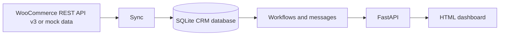

# WooCRM

**Analyse, design and implement a CRM system that integrates with WooCommerce.**

WooCRM is a lightweight customer relationship management dashboard for WooCommerce stores. It brings customer profiles, order activity, customer segments, and automated communication workflows together in one place.

## Problem Statement

Store owners often need to switch between order records, customer details, and separate communication tools to understand customer activity. WooCRM combines this information in a small CRM that can use local sample data during development or sync from the WooCommerce REST API.

## Features

- **Customer data management:** Browse, search, and filter customer profiles with contact details, order history, spend, and segment.
- **Order tracking:** View orders and status history; simulate status changes to exercise communication workflows.
- **Communication workflows:** Create a message record and console email preview for supported order statuses; send a 10% win-back offer to At-risk customers.
- **RFM-lite segmentation:** Classify customers as VIP, At-risk, Repeat, or New using total spend, order count, and last order date.
- **Dashboard overview:** See customer, order, revenue, and segment totals in a responsive single-file frontend.

Messages are stored and printed to the backend console for this prototype; they are not sent to real email addresses.

## Architecture



## Tech Stack

- Python 3.13
- FastAPI and Uvicorn
- SQLite through Python's standard-library `sqlite3`
- `requests` for WooCommerce REST API calls
- `python-dotenv` for local environment variables
- Pydantic for API request validation
- Single-file HTML, CSS, and JavaScript frontend using `fetch()`

## Database Schema

The database file is `backend/crm.db`, created automatically on API startup.

| Table | Purpose | Key fields |
| --- | --- | --- |
| `customers` | WooCommerce customer profile and computed CRM summary | `woo_id` (unique), name, email, phone, city, total spent, order count, last order date, segment |
| `orders` | Current CRM copy of WooCommerce orders | `woo_id` (unique), customer WooCommerce ID, status, total, created and updated dates |
| `order_events` | Order status-change timeline | order WooCommerce ID, status, timestamp |
| `messages` | Sent-message history and rendered body | customer and order WooCommerce IDs, template, body, sent timestamp |

During sync, customer spending, order count, and last-order date are recomputed from non-cancelled orders. Revenue in the stats endpoint also excludes refunded orders.

## API Endpoints

The interactive API documentation is available at `/docs` while the backend is running.

| Method | Endpoint | Description |
| --- | --- | --- |
| `GET` | `/` | Serve the dashboard from `frontend/index.html`. |
| `POST` | `/sync` | Upsert WooCommerce/mock customers and orders, record new or changed order statuses, and recompute customer summaries. Returns `customers`, `orders`, and `new_messages` counts. |
| `GET` | `/customers?segment=VIP` | List customers; `segment` is optional. |
| `GET` | `/customers/{woo_id}` | Return `{ "profile": ..., "orders": [...], "messages": [...] }`; returns 404 if the customer does not exist. |
| `GET` | `/orders?status=processing` | List orders; `status` is optional. |
| `GET` | `/orders/{woo_id}/timeline` | Return the order's status events in timestamp order. |
| `GET` | `/messages` | List saved messages, newest first. |
| `GET` | `/stats` | Return `total_customers`, `total_orders`, `total_revenue`, `counts_per_segment`, `counts_per_order_status`, and `mode` (`mock` or `live`). |
| `POST` | `/simulate/status` | Accept `{"order_id": 1001, "status": "completed"}`, update the order, and run its status workflow. |
| `POST` | `/workflows/winback` | Send a win-back message to each At-risk customer; returns `{ "count": n }`. |

## Setup (Windows PowerShell)

From the project root, create and activate a virtual environment, then install dependencies:

```powershell
py -3.13 -m venv venv
.\venv\Scripts\Activate.ps1
python -m pip install --upgrade pip
python -m pip install -r requirements.txt
```

Run the backend from the `backend` directory. The plain imports in the project expect this working directory:

```powershell
cd backend
uvicorn main:app --reload
```

Open `http://127.0.0.1:8000/` for the dashboard or `http://127.0.0.1:8000/docs` for the API docs. On the first run, click **Sync from WooCommerce** to load the sample records.

If PowerShell blocks virtual-environment activation, run the environment's executables directly from the project root, then start Uvicorn from `backend`:

```powershell
.\venv\Scripts\python.exe -m pip install -r requirements.txt
cd backend
..\venv\Scripts\python.exe -m uvicorn main:app --reload
```

## Switch to a Live WooCommerce Store

By default, WooCRM uses `CUSTOMERS` and `ORDERS` from `data/mock_data.py`. To use a live store:

1. In WooCommerce, create REST API credentials with read access (WooCommerce **Settings → Advanced → REST API**).
2. Create a `.env` file in the project root, beside `requirements.txt`:

   ```dotenv
   WC_URL=https://your-store.example
   WC_KEY=ck_your_consumer_key
   WC_SECRET=cs_your_consumer_secret
   ```

3. Replace the example values with your store URL and credentials. Keep the secret private; `.env` is excluded by `.gitignore`.
4. Restart the backend. When `WC_URL` is set, the dashboard mode changes to **Live** and sync requests the WooCommerce REST API v3 customers and orders endpoints, fetching pages of up to 100 records.

Remove or unset `WC_URL` and restart the backend to return to **Mock mode**. `WC_KEY` and `WC_SECRET` are required for authenticated live API access.

## Five-Step Demo

1. Start the backend in `backend/` and open the dashboard. Confirm the mode chip says **Mock mode**.
2. Click **Sync from WooCommerce**. The 12 sample customers and 30 orders populate the overview and tables.
3. In **Customers**, filter to **At-risk** and open a profile to show its details, orders, and message history.
4. In **Orders**, open an order to show its status timeline. In **Communications**, simulate a status change and show the generated message in the log.
5. Run the win-back campaign and show the confirmation and newly recorded 10% offer messages.

## Future Work

- WooCommerce webhooks for near-real-time order and customer updates.
- WhatsApp and SMS delivery integrations for customer communications.
- Machine-learning churn prediction to improve retention targeting.